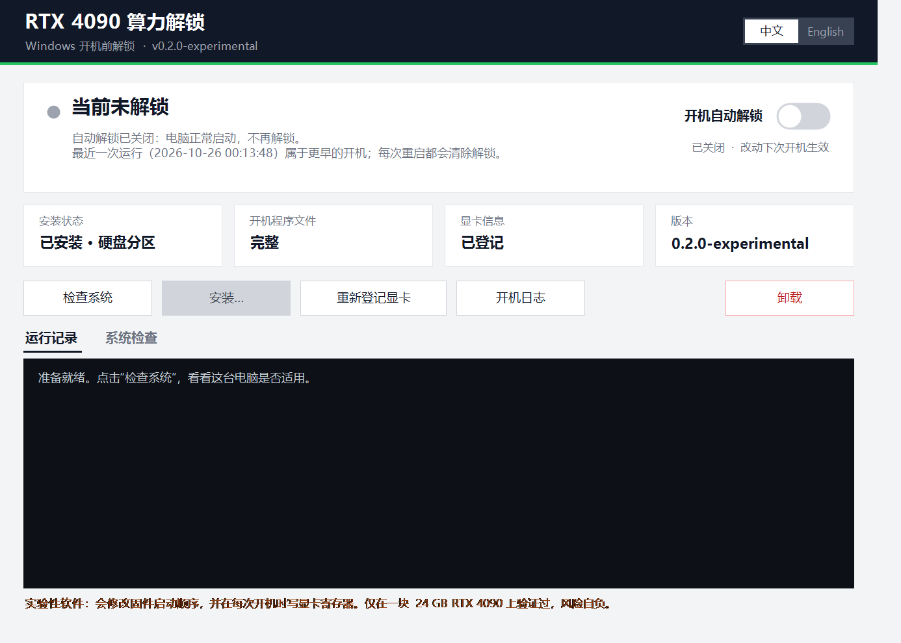

# RTX 4090 算力解锁（Windows）

[English](README.md)

一个带图形界面和开关的 Windows 一键安装器。每次开机时，在 Windows 加载 NVIDIA 驱动**之前**，它会把 GeForce RTX 4090（24 GB）上被限速的 **FP32 累加张量核心**打开到满速。

> **实验性软件，只在一台电脑上验证过。** 它会修改固件启动顺序，并在每次开机时对显卡写寄存器。请先读[风险](#风险)，使用风险自负。



## 能得到什么

测试卡的矩阵乘吞吐（RTX 4090 24 GB，功耗上限 450 W，PyTorch，单次测量）：

| 测试 | 未解锁（TFLOPS） | 解锁后 | 变化 |
|---|---|---|---|
| TF32 4096³ | 83.7 | ≈130 | **+55%**（每 GHz 约 2 倍） |
| FP16（FP32 累加）4096³ | 159.3 | ≈214 | **+35%** |
| FP16（FP32 累加）8192³ | 152.9 | ≈168 | +10% |
| BF16（FP32 累加）8192³ | 156.5 | ≈178 | +14% |
| FP16（FP16 累加）、FP32 CUDA 核心 | — | — | 不变 |

- 解锁前后的数值结果逐位相同。
- 显卡一直顶在功耗上限，频率会下降，所以达不到理论上的 2 倍。
- 游戏、DLSS、光追、INT8、大模型逐词生成不受益。真实应用（训练、ComfyUI、LLM 预填充）没有实测。

## 工作原理

1. **安装**：在内部硬盘划一个 300 MiB、没有盘符的隐藏 FAT32 分区（也可以用你指定的 FAT32 U 盘），放进一个 UEFI 小程序，并在固件启动顺序里加一项 `GPU Unlock (auto)`，排在 Windows 前面。
2. **固件文件**：约 330 MB 的 NVIDIA 固件输入**在你自己的电脑上下载并提取**，每个文件都和固定的 SHA-256 核对。本仓库不包含任何 NVIDIA 固件。
3. **每次开机**：小程序先确认是预期的那张卡、处于冷态，然后让显卡里签过名的固件应用设置，复位显卡，把显示交还给固件，再启动 Windows。屏幕会短暂黑一下。任何一项检查没通过，就不写显卡，Windows 照常启动。
4. **第一次开机**：程序会先只读地记下这张卡的身份（保存为 `PROFILE.TXT`），然后在同一次开机里解锁。
5. **断电即失效**：设置在断电或重启后会丢失，所以每次开机都要重新应用。开关决定的是**下次开机**解不解锁，因为解锁必须在 NVIDIA 驱动加载之前完成。

## 适用条件

安装器的"检查系统"会逐项检查，任何一项不满足都会拒绝安装。

| 项 | 要求 |
|---|---|
| 显卡 | 恰好一张 GeForce RTX 4090，PCI `10de:2684`，24 GB |
| 系统 | Windows 10 / 11，64 位 |
| 启动方式 | UEFI（不是 Legacy/CSM） |
| Secure Boot | **必须关闭**（开机程序没有签名） |
| BitLocker / 设备加密 | **必须关闭**（改启动路径会触发恢复密钥） |
| 显示器 | 只接在这张 4090 上 |
| 空间 | GPT 磁盘上一个能缩小 304 MiB 的 NTFS 卷，或一个有 150 MB 空闲的 FAT32 U 盘；下载另需约 400 MB |

**不支持**：48 GB 魔改卡、4090 D、笔记本 4090、多显卡、Secure Boot 开启。

## 已验证与未验证

| 测试机上已验证 | 未验证 |
|---|---|
| Windows 11 专业版 24H2（26100），驱动 610.88 | Windows 10、家庭版、Server 版 |
| 华硕 ROG STRIX Z790-H（BIOS 3107）、i7-14700KF、华硕 RTX 4090 | 其他主板和其他品牌的 4090；有些主板固件不认、或会重置 Windows 里改的启动顺序 |
| 安装、卸载（被缩小的卷恢复到精确原大小）、开关开/关 | U 盘模式、安装失败后的回滚 |
| 首次开机登记并解锁、冷启动和重启后自动解锁，成功解锁十余次 | 睡眠（S3）唤醒后（预计会失效）、开启快速启动时、Windows 或 BIOS 更新之后 |
| 用预先放好的缓存核对下载哈希 | 全新电脑上真正联网下载 |
| 100% 缩放，以及模拟 125%/150% 缩放下的界面 | 用户名或路径里有中文等非 ASCII 字符 |

**非常欢迎反馈其他机器的结果。** 请提 issue，附上主板、BIOS 版本、显卡品牌、Windows 版本和开机日志（窗口里的"开机日志"按钮，`FINAL` 行最重要）。

## 安装

1. 在 BIOS 里**关闭 Secure Boot**；在 Windows 里**关闭 BitLocker / 设备加密**。重要数据先备份。
2. 下载发布包（或克隆本仓库），打开 `installer\`，双击 **`GPU-Unlock-Installer.cmd`**，在弹出的管理员提示里选"是"。
3. 点 **"检查系统"**，所有项都要显示"通过"；"注意"只是提醒。
4. 点 **"安装…"**，选内部硬盘小分区（推荐）或 U 盘，勾选风险确认，点 **"开始安装"**。
5. 提示重启时选"是"。

界面是纯中文或纯英文，在右上角 **中文 / English** 切换。

命令行（在 `installer\` 里打开管理员 PowerShell）：

```powershell
powershell -ExecutionPolicy Bypass -File core.ps1 check
powershell -ExecutionPolicy Bypass -File core.ps1 install -Mode partition -TargetVolume D -DryRun
powershell -ExecutionPolicy Bypass -File core.ps1 enable | disable | status | logs | reenroll | uninstall
```

`-DryRun` 只打印计划，不做任何改动；`-Lang en|zh` 指定输出语言。

## 日常使用

- **开关**："开机自动解锁"开关从下次开机起生效。
- **看状态**：大卡片显示**本次开机**是否已解锁。每次重启都会清除解锁；开关开着时，下次开机会重新解锁。
- **某次不解锁**：开机按主板的启动菜单键（华硕一般是 F8，其他常见 F11/F12），选 Windows Boot Manager。
- **重新登记显卡**：换显卡、升级 BIOS 或改动主板设置之后使用。
- **卸载**：删除启动项和小分区，并把空间还给原来的卷。

想自己确认速度，可以运行 `python tools/bench_gemm.py 名字`（需要装 CUDA 版 PyTorch），对比一次未解锁开机和一次解锁开机的结果。TF32 的差别最明显。

完整说明书见 [docs/MANUAL-zh.md](docs/MANUAL-zh.md)，包括排障、文件位置和用 `bcdedit` 手动停用的方法。

## 风险

- **可能黑屏**：每次开机都会对显卡写寄存器，没有人在旁边看着。事务中途失败时，程序会停住并要求断电，开机会卡在黑屏。这时长按电源键关机，再开机从启动菜单进 Windows Boot Manager，然后在窗口里把开关关掉。
- **会改动硬盘**：分区模式会缩小你的一个卷，请先备份。
- **没有签名**：脚本和 EFI 程序都没有签名，杀毒软件或 SmartScreen 可能报警。你可以自己从源码构建 EFI 并比对哈希，见 [efi/README.md](efi/README.md)。
- **法律**：以下不是法律意见。NVIDIA 驱动和固件的许可条款、反规避法规（例如美国 17 U.S.C. §1201）、出口管制规则可能适用于你所在的地区，请自行判断能否使用。

## 目录结构

| 路径 | 内容 |
|---|---|
| `installer/` | `GPU-Unlock-Installer.cmd`、`gui.ps1`（图形界面）、`core.ps1`（所有操作）、`payload/`（预编译的 `gpuunlock.efi`、哈希清单、本地提取固件的工具） |
| `efi/` | `gpuunlock.efi` 的完整源码、构建脚本、相对上游的补丁 |
| `tools/bench_gemm.py` | 解锁前后对比用的基准测试 |
| `docs/` | 中文说明书和截图 |

## 致谢与许可

本项目建立在公开的研究和代码之上，包括 [Zagitta/gpu-unlock](https://github.com/Zagitta/gpu-unlock)、[TOTORONG/AD103_win_unlocker](https://huggingface.co/TOTORONG/AD103_win_unlocker)、[brandonjank/gpu-unlock-ada](https://github.com/brandonjank/gpu-unlock-ada) 等，详见 [NOTICE.md](NOTICE.md)。

以 **GPL-2.0-only** 发布（见 [LICENSE](LICENSE)），第三方部分保留各自的声明。本项目与 NVIDIA 无关，也未获其认可。NVIDIA、GeForce、RTX 是 NVIDIA Corporation 的商标，这里只用来说明适用的硬件。
